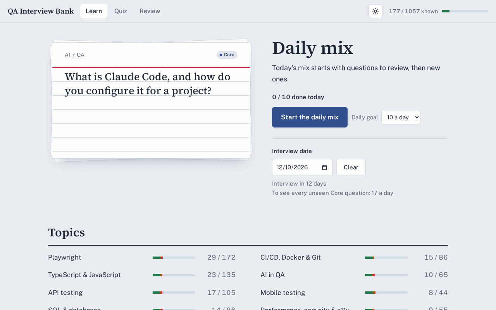
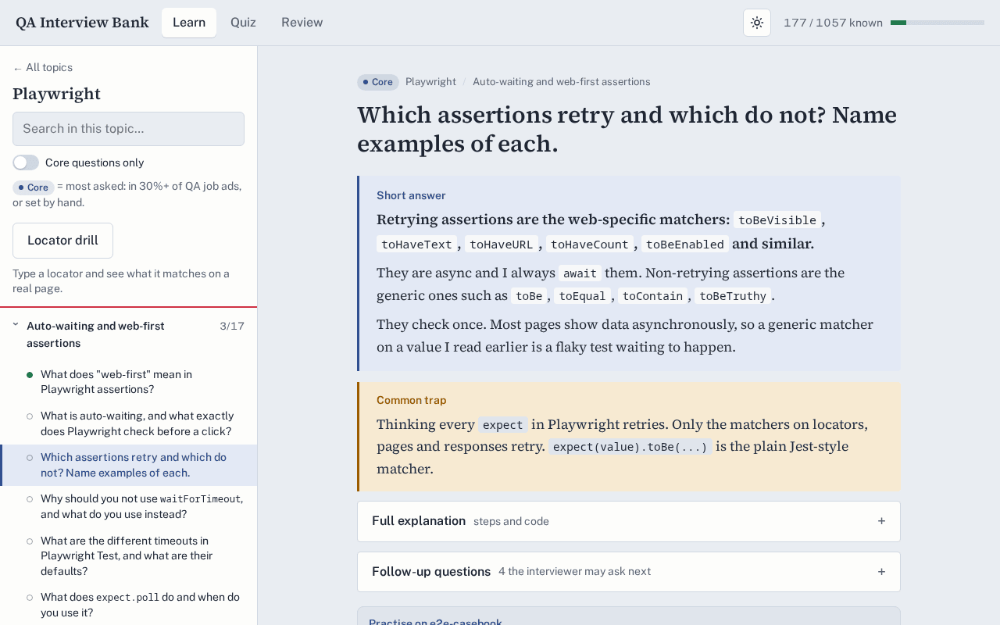
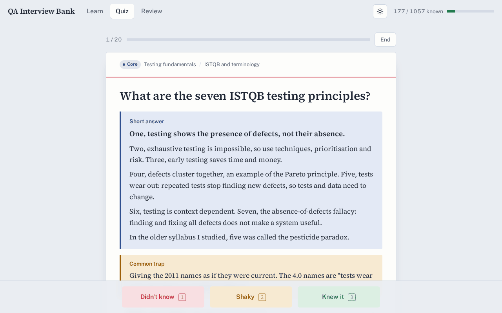
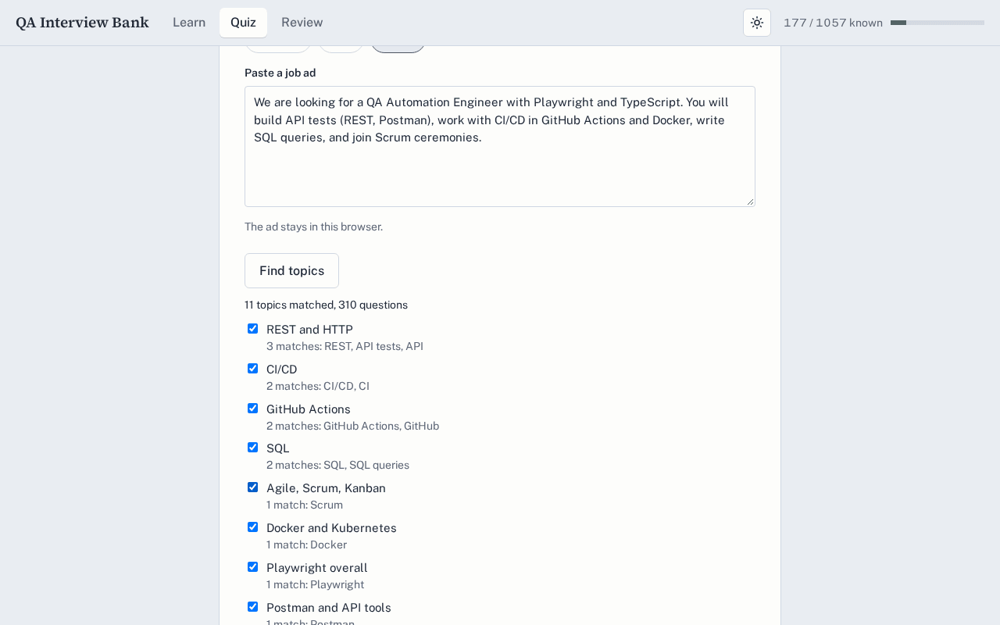
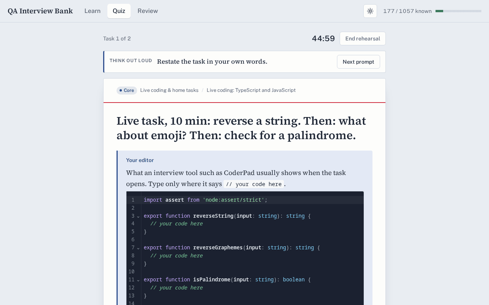
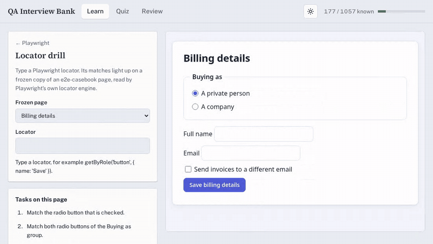
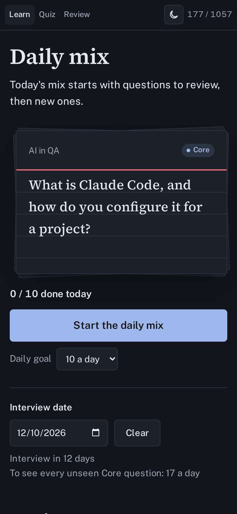

# QA Interview Bank

About 1,000 interview questions for QA and test automation roles. Each one has a short answer to say out loud, the common trap, a full explanation and the likely follow-up questions.

Topics: Playwright, TypeScript and JavaScript, API testing, SQL, testing fundamentals, framework design and flaky tests, CI/CD and Docker, AI in QA, mobile, performance, security and accessibility, agile and leadership, and live-coding tasks.

**Try it now:** [bartech-lab.github.io/qa-interview-bank](https://bartech-lab.github.io/qa-interview-bank/). After one visit it also opens without a network.



## Open it

Or keep your own copy: download `qa-interview-bank.zip` from the latest [release](https://github.com/bartech-lab/qa-interview-bank/releases/latest), unzip it and double-click `index.html`.

Or build it yourself. You need Python 3.9 or newer (`python3 --version` shows it). Nothing else.

1. Get the files: on GitHub press **Code → Download ZIP** and unzip it, or run `git clone https://github.com/bartech-lab/qa-interview-bank.git`.
2. In a terminal, inside that folder, run:

   ```sh
   python3 tools/build.py
   ```

   It prints a line starting `OK: 1057 questions -> dist/index.html`. It also writes `dist/qa-interview-bank.zip`, the same page packed with the Markdown, for sharing.
3. Double-click `dist/index.html`. It opens in your browser and works offline.

On Windows, use `py tools/build.py` if `python3` is not found.

## Use it

- **Learn**: pick a topic, then read question by question. The arrow keys move between questions. Press **Mark as known** when you can answer it.
- **Quiz**: pick topics, which tiers and how many questions. Answer out loud, press Space to reveal, then 1 (didn't know), 2 (shaky) or 3 (knew it). At the end you can repeat the ones you missed.
  - Pick topics from the list, by role (Manual QA, Automation, SDET, Lead), or paste a job ad: the page finds its topics. The ad stays in your browser.
  - **Mock interview**: a clock runs while you answer, a structure guide, then the model answer.
  - **Live-coding rehearsal**: up to five coding tasks against one clock, with prompts to think out loud.
- **My cards**: add your own questions, for example from a company's interview, with a note per company. They go into Export progress.
- **Locator drill** (in Learn, Playwright): type a Playwright locator and see what it matches on a real page.

### What it looks like

| Learn: a short answer to say out loud, the common trap, then the details | Quiz: rate each answer, and spaced review brings it back |
|---|---|
|  |  |
| **Job ad: paste an ad and the page picks its topics** | **Live-coding rehearsal: real tasks in an editor that runs the code** |
|  |  |

**Locator drill**: type a locator and see what it matches. Here `getByLabel('Email')` also matches the checkbox label, and `exact: true` narrows it to the field.





Your progress stays in this browser only. A copy opened from another folder or another browser starts empty.

The answers are written as a script you can say in first person. Where an answer depends on your own experience, it tells you to say what you really did. Never claim experience you do not have.

## Core, Standard, Niche

- **Core**: the topic appears in 30% or more of 537 QA job ads scanned in November 2026, or it is set to Core by hand. Start here.
- **Standard**: in 10 to 30% of those ads.
- **Niche**: under 10%. Read it when a job ad names the topic.

[docs/tiers.md](docs/tiers.md) lists every topic with its share of ads.

## Found a mistake?

Under every answer there is a **Report a problem with this answer** link. It opens a GitHub issue with the question and its id filled in. Add a link that shows the correct fact.

## Change the questions

The questions are plain Markdown in `topics/`, one file per topic. [CONTRIBUTING.md](CONTRIBUTING.md) shows the format, the checks to run and how to propose a change.

Every release also carries `questions.json`: all questions with their ids, topics and tiers, for reuse under CC BY-SA 4.0.

## Licence

Code: MIT ([LICENSE](LICENSE)). Questions and answers: CC BY-SA 4.0 ([LICENSE-CONTENT.md](LICENSE-CONTENT.md)). Fonts: SIL Open Font License 1.1, with the text at the end of `index.html` and in [src/fonts/OFL.txt](src/fonts/OFL.txt).
